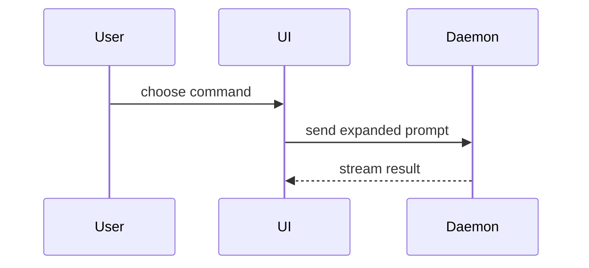

# Writing a pull request description

The PR description exists so a reviewer can understand the change and judge its risk fast, before reading the diff. This file is the one template for it: use it for every PR you create and every description you rewrite.

## Template

Write the headings in the project's language, the same way rule 7 matches issues to it. English:

```markdown
Part of #N

## Summary

<the smallest view that makes the change clear: pseudocode, tree, Mermaid, or diff sketch>

## Evidence

- **Before:** <screenshot, output, or failing test run>
  **After:** <screenshot, output, or passing test run>

## Merge Danger

**Door:** <one-way or two-way>

<optional: why>

**Blast radius:** <one word>

<optional: what could break on merge>
```

German-language project:

```markdown
Bezug: #N

## Zusammenfassung

<die kleinste Darstellung, die die Änderung klar macht>

## Nachweis

- **Vorher:** <Screenshot, Ausgabe oder fehlschlagender Testlauf>
  **Nachher:** <Screenshot, Ausgabe oder grüner Testlauf>

## Merge-Risiko

**Tür:** <Einweg oder Zweiweg>

<optional: warum>

**Wirkungsradius:** <ein Wort>

<optional: was beim Merge brechen kann>
```

The first line links the issue without closing it (rule 3): `Part of #N`, or `Bezug: #N` on a German-language project, `owner/repo#N` for an issue in another repository. Never `Closes`, `Fixes` or `Resolves`. One line per issue when the PR spans several.

Write the body to a file and pass it with `--description-file` to `meyden-gh pr create`; for an existing PR, `gh pr edit <n> -F pr.md`.

No preamble, no restated title, no "This PR…" opener. Keep prose brief and use the domain language from the project's `CONTEXT.md`: the reviewer should meet the same terms here that they meet in the issues and the code.

## Summary

When the `dev-workflow:show-me` skill is available, produce this section with it (Skill tool). Otherwise pick the smallest view from the catalogue below that makes the key point clear. Everything below renders in GitHub's Markdown, Mermaid included.

Logic or an algorithm as pseudocode:

```text
on(save)
  if content is unchanged
    return cached result
  write new content
  return fresh result
```

Runtime control flow as a call tree:

```text
submitForm
  createSession
    persistPrompt
    launchAgent
  navigateToSession
```

UI structure as a component tree, including the state and module boundaries that matter:

```text
<SessionPage>                 apps/example/src/routes/session.tsx
  useSessionEvents()
  <SessionToolbar>
    <RunSkillButton>          packages/ui
```

File responsibility or a broad refactor as a shallow file tree:

```text
src/
├── commands/       # parses user actions
├── sessions/       # owns session state
└── transport/      # sends API requests
```

Component interaction, control flow or data flow as Mermaid:



A `diff` block when the point is what changes and the surrounding shape already exists. Match the diff's shape to the topic.

A component change:

```diff
 <SessionPage>
   useSessionEvents()
   <SessionToolbar>
+    <RunSkillButton />
   <SessionTimeline>
+    <SkillResultCard />
```

A file-layout change:

```diff
 src/
 ├── commands/
+│   └── show-me.ts       # expands the slash command
 ├── sessions/
-└── transport.ts
+└── transport/
+    ├── client.ts
+    └── stream.ts
```

A call-tree change:

```diff
 submitForm
   createSession
     persistPrompt
+    expandSkillMention
     launchAgent
-  navigateToSession
+  navigateToSession
+    subscribeToEvents
```

A state or control-flow change:

```diff
 on(save)
-  write content
+  if content is unchanged
+    return cached result
+  write new content
+  invalidate cache
```

The whole block, when most of it is new, when omitted context would hide ownership or order, or when the reviewer needs a copyable target shape:

```ts
function expandSkill(command: string): string {
  const skillName = command.slice(1);
  return `use the ${skillName} skill`;
}
```

Place each visual next to the short text it supports. Keep only the calls, files, props, states and boundaries the reviewer needs to understand this change. One view is often enough and several are sometimes right; all of them never are.

## Evidence

Concrete proof that the change works, as a before and after pair.

Screenshots are the strongest evidence when the change is visual and the environment can produce them. `gh` and the REST API cannot upload an image, so a screenshot has to be attached in the PR's web editor (drag it into the description), which turns it into a hosted link; a local file path in the description shows nothing. When the environment cannot do that, leave the screenshot out and use execution-based evidence.

Execution-based evidence comes next: test results, console output. Name the exact test that failed before and passes now, sketched as pseudocode if the real one is long.

## Merge Danger

**Door.** A two-way door can be walked back through: reverting the merge restores the old state. A one-way door can't: destructive migrations, deleted data, a published API or schema that consumers will adopt, a sent notification. A PR that is cheap to roll back is lower risk, so say which kind this is, and for a one-way door say what makes it irreversible.

**Blast radius.** The potential scope of impact if the change is wrong. Consider all of it: layout shift, mobile responsiveness, breakage for consumers of an API or a shared module, other repositories in the same epic (rule 6), deploy or CI behaviour. One word for the size, then the specific ramifications if there are any worth naming.

## Credits

Adapted from Matt Pocock's [`pr`](https://github.com/mattpocock/skills) skill. Its Summary section is Dex Horthy's [`show-me`](https://github.com/humanlayer/skills/blob/main/plugins/show-me/skills/show-me/SKILL.md) skill (HumanLayer), reproduced almost word for word and aimed at a diff instead of a live conversation.
